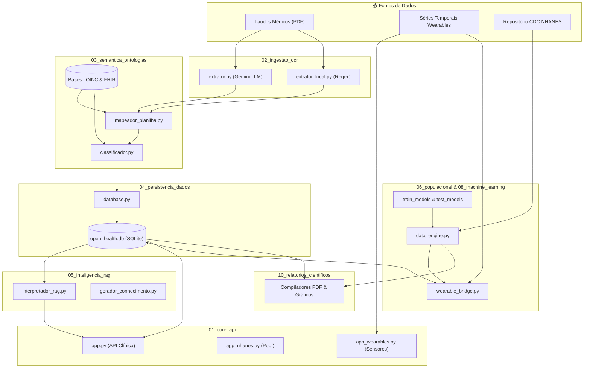

# 🏛️ Arquitetura do Backend — Open Health Brasil (Hackathon LEPoli)

Esta pasta consolida e categoriza **todos os componentes de backend** da plataforma Open Health Brasil, organizados modularmente por responsabilidades.

## 📂 Estrutura de Pastas por Sessões

- [**`01_core_api/`**](./01_core_api): Sessão 01: Core Web & APIs de Serviços (Flask / Microserviços)
- [**`02_ingestao_ocr/`**](./02_ingestao_ocr): Sessão 02: Pipeline de Ingestão & OCR de Laudos
- [**`03_semantica_ontologias/`**](./03_semantica_ontologias): Sessão 03: Padronização Semântica & Ontologias (LOINC / FHIR)
- [**`04_persistencia_dados/`**](./04_persistencia_dados): Sessão 04: Persistência & Longitude Relacional (SQL / SQLite)
- [**`05_inteligencia_rag/`**](./05_inteligencia_rag): Sessão 05: Inteligência Médica & RAG (Retrieval-Augmented Generation)
- [**`06_populacional_nhanes/`**](./06_populacional_nhanes): Sessão 06: Big Data Populacional & Bridge Wearables (CDC NHANES)
- [**`07_sensores_wearables/`**](./07_sensores_wearables): Sessão 07: Sensores Wearables & Séries Biométricas
- [**`08_machine_learning_causal/`**](./08_machine_learning_causal): Sessão 08: Modelos Preditivos & Inferência Causal
- [**`09_geradores_sinteticos/`**](./09_geradores_sinteticos): Sessão 09: Geradores de Dados Sintéticos & Ferramentas Auxiliares
- [**`10_relatorios_cientificos/`**](./10_relatorios_cientificos): Sessão 10: Motores de Relatórios Científicos & Gráficos Automatizados

---

## 🔄 Fluxograma Arquitetural Geral

